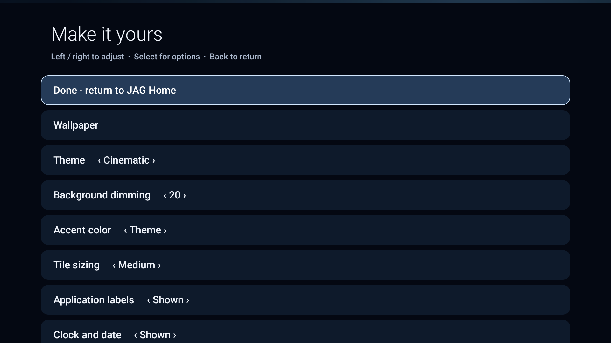

# JAG Home v2 · cinematic development preview

**V3 stable HOME integration is a separate variant.** See the
[owner-operated migration tool and recovery guide](home/README.md) and
[stable signing instructions](stable/SIGNING.md). The development APK described
below retains its existing identity and no-op HOME hooks. No device activation
is performed by this branch or by CI.

A native Java TV home for Fire TV Stick 3rd generation / Fire OS 7.7.1.7,
with an original cinematic design, four themes and no network permission.

**Package: `com.jag.home.dev` · versionCode 2 · versionName `0.2-dev`.**
This remains a manually opened application. There is no HOME intent filter,
accessibility service, boot component or change to dumbtv's working integration.
The original cloud v1 signing key is retained. Read [SIGNING.md](SIGNING.md)
before updating: your installed v1 APK may have come from an independently
signed CI build. No device is contacted or deployed to by this cloud task.

## The v2 experience



This actual emulator capture shows the missing-app fallback design. The real
streaming/VPN apps are not installed there; their installed banners/icons are
resolved at runtime. [Ultra Minimal capture](docs/ultra-minimal.png) shows the
static benchmark appearance. These are not Fire Stick performance measurements.

- Six 16:9 artwork cards, original monogram/tonal fallbacks, restrained rounded
  rims and 120 ms focus scaling. Square icons retain their proportions. Native
  banners/icons are resolved with PackageManager, off the UI/input thread.
- Four token-based themes: **Cinematic** (default, optional photograph),
  **Midnight** (blue/black), **Graphite** (slate/white), and **Ultra Minimal**
  (nearly black, static focus, reduced metadata). No live blur or animation loop.
- Compact **Recently Opened**, enabled by default and hidden while empty. It
  contains at most four unique favorites successfully opened by JAG, newest
  first. It is not Android's global recent list. Disabling it also stops
  recording; clearing it is explicit. No usage access, timestamps, viewing
  history, background monitoring or accessibility tracking.
- Integrated icon dock: **Wallpaper · Customize · Memory Status · System Settings**.
  Time/date use visible-only Android time broadcasts, with saved 12/24-hour format.
- Static JPG/PNG/WebP wallpaper, sampled off-thread to at most 1080p, cached while
  visible. Adjustable dimming and a dark card-area gradient maintain readability.
  Missing, corrupt, oversized or unsupported images use the atmospheric default.
- All v1 preferences and favorite order remain readable. Added theme, Reduce
  Motion, recent on/off and clear controls. Visual reset keeps order/history and
  a user's history opt-out. Back/Select/Menu/long Select are remote-operated.

The six favorites remain Netflix, Sony LIV, JioHotstar, YouTube, FanCode and
ExpressVPN, in that default order. Missing or disabled apps retain their slots
with an unavailable state; JAG never enables, removes or clears them. Launch
activities come from PackageManager, never guessed class names.

Ultra Minimal deliberately ignores wallpaper, hides decorative section/date/app
labels, and disables scale animations. The stored preferences/wallpaper remain
intact when switching back. Midnight and Graphite also use their own static
backgrounds; choose Cinematic to display a selected photograph. Reduce Motion,
low-RAM classification, memory pressure and software rendering select static
focus treatment while retaining a visible border. These are conservative
rendering choices, not measured claims of better Fire Stick performance.

Runtime uses native Views/Canvas, system fonts and no dependencies. Six bounded
artwork bitmaps are shared by favorites and recent cards; recent entries do not
load duplicate images. Images are released when hidden. Package-change work is
coalesced, and focus never decodes an image or rebuilds layout. No advertising,
tracking, cloud images, background polling or recurring cleaner is included.

## Memory Status

Memory Status reads real available/total memory on demand and explains Android's
background-process management. **No apps were stopped.** There is no kill/cache/
data/disable operation or permission. The page offers supported app-management
Settings shortcuts with fallbacks; leave active playback and VPN settings alone.
JAG never operates destructive controls on those pages. See the API investigation
in [ARCHITECTURE.md](ARCHITECTURE.md).

## Build and signing

## Build on Windows using WSL

The supported Windows build path is **WSL 2 with Ubuntu 24.04**, using Linux JDK
and SDK tools inside WSL. Do not mix Windows SDK executables with this Linux
build. Android Studio is optional. Installing the resulting APK can use your
existing Windows `adb.exe` in Git Bash.

In WSL:

```bash
sudo apt-get update
sudo apt-get install -y openjdk-17-jdk-headless python3 curl unzip zip git
export JAVA_HOME=/usr/lib/jvm/java-17-openjdk-amd64
export ANDROID_HOME="$HOME/Android/Sdk"
export ANDROID_SDK_ROOT="$ANDROID_HOME"
export PATH="$JAVA_HOME/bin:$ANDROID_HOME/cmdline-tools/latest/bin:$PATH"
mkdir -p "$ANDROID_HOME/cmdline-tools"
curl -fL https://dl.google.com/android/repository/commandlinetools-linux-16111833_latest.zip -o /tmp/jag-commandlinetools.zip
printf '%s  %s\n' e025545c62a8e64c7559119566a569fb1dec5f60 /tmp/jag-commandlinetools.zip | sha1sum -c -
unzip -q /tmp/jag-commandlinetools.zip -d "$ANDROID_HOME/cmdline-tools"
mv "$ANDROID_HOME/cmdline-tools/cmdline-tools" "$ANDROID_HOME/cmdline-tools/latest"
sdkmanager --licenses
sdkmanager 'platforms;android-25' 'build-tools;34.0.0'
```

The archive checksum above is the value in Google's SDK repository metadata for
this exact tools archive. Do not disable verification or replace the expected
digest on failure. Review the Android SDK licenses when prompted. If you already
have command-line tools, reuse them rather than overwriting their installation.

Clone your branch into the WSL filesystem, then build:

```bash
git clone --branch feat/jag-home-v2 https://github.com/1invito/jag-home.git
cd jag-home
./launcher/jag/test.sh
# Supply the retained key/password securely as described in SIGNING.md first.
./launcher/jag/build.sh
sha256sum launcher/jag/build/jag-home-dev.apk
```

Output: **`launcher/jag/build/jag-home-dev.apk`**. The cloud build uses the same
JDK 17 / platform 25 / build-tools 34.0.0 pipeline. No Gradle is used.
For subsequent WSL sessions, restore `JAVA_HOME`, `ANDROID_HOME`,
`ANDROID_SDK_ROOT` and `PATH` above. This procedure requires x86-64 Linux/WSL;
ARM Windows needs a compatible x86-64 build environment.


The signed output is **`launcher/jag/build/jag-home-dev.apk`**. Supply the retained
keystore and environment passwords following [SIGNING.md](SIGNING.md); the builder
fails safely if they are unavailable or the certificate differs. It no longer
silently generates a new key. CI produces the clearly named **unsigned**
`jag-home-dev-unsigned.apk` for compilation validation, not an installable update.
Never commit private signing material or paste passwords into chat.

## Manual Windows Git Bash update

First compare the installed and new APK signer fingerprints as described in
[SIGNING.md](SIGNING.md). If different, stop and keep the working preview. Copy the
signed APK from WSL to your Windows checkout, for example:

```bash
# WSL: use your actual Windows checkout path.
mkdir -p /mnt/c/Users/YOUR_NAME/Projects/jag-home/launcher/jag/build
cp launcher/jag/build/jag-home-dev.apk /mnt/c/Users/YOUR_NAME/Projects/jag-home/launcher/jag/build/
```

Then from Windows Git Bash in that checkout:

```bash
export ADB_SERIAL='TV_ADDRESS:5555'
adb connect "$ADB_SERIAL"
adb -s "$ADB_SERIAL" get-state
# Continue only if state is device and the certificate comparison matched.
adb -s "$ADB_SERIAL" install -r launcher/jag/build/jag-home-dev.apk
adb -s "$ADB_SERIAL" shell am start -W -n com.jag.home.dev/.Home
```

Accept an authorization prompt on the TV if needed; do not retry in a loop.
`install -r` is an in-place update only for a matching certificate, retaining
JAG's private settings. Never use `pm clear`, uninstall the working launchers,
change accessibility/default HOME, or invoke upstream install/cleanup/restore
scripts to fix an update error. The old and new cloud artifact certificates
match, but this does not establish your installed APK's signer.

## Local wallpaper with the remote

Choose Wallpaper in the dock, select a local image or Default, then Back to return.
Some Fire OS builds lack a usable document picker. In that case put an image in
JAG's own folder from Windows Git Bash and reopen Wallpaper:

```bash
MSYS_NO_PATHCONV=1 adb -s "$ADB_SERIAL" shell mkdir -p /sdcard/Android/media/com.jag.home.dev/wallpapers
MSYS_NO_PATHCONV=1 adb -s "$ADB_SERIAL" push 'C:/Users/YOUR_NAME/Pictures/wallpaper.jpg' /sdcard/Android/media/com.jag.home.dev/wallpapers/
```

The app also scans its own external-files `wallpapers/` folder. No storage
permission is requested. Use a landscape still, preferably 1920 × 1080, at most
32 MB. At most 100 candidate files are offered. Opaque pictures prefer RGB_565;
alpha images may need ARGB_8888. No images are downloaded or rotated. Wallpaper
selection is retained when using a non-photo theme and shown again in Cinematic.

## Testing, performance and recovery

Run `./launcher/jag/test.sh` and build. See [TESTING.md](TESTING.md) for native
emulator checks, the physical Fire OS acceptance checklist, comparable warm/cold
measurements and the 10% latency / 10–15 MB PSS targets. Those targets are
**unmeasured on the Fire Stick**, not achievements inferred from APK size.
Test fixtures and instrumentation are separate emulator-only APKs; they are not
included in the signed development APK and do not represent real streaming apps.

Press the remote's **Home** button to use the existing dumbtv binding. Back exits
settings/dialogs predictably and exits the preview from its home screen. Customize
also offers Return to existing dumbtv. If needed, manually launch the retained
app without guessing its activity:

```bash
adb -s "$ADB_SERIAL" shell monkey -p tv.dumbtv.home -c android.intent.category.LEANBACK_LAUNCHER 1
```

V2 does not change HOME/accessibility/global settings, DNS, installed streaming
apps, account data or debloating state. No restoration script is needed. Do not
uninstall JAG to roll back an update error; ordinary APK downgrades may be
refused. Keep using dumbtv and prepare a same-key forward fix if necessary.
The stable-package handover is a separate, design-only deliverable in
[HOME_MIGRATION_V2.md](HOME_MIGRATION_V2.md), with snapshots, scoped rollback and
failure recovery. There is **no HOME takeover in this PR**.

## Attribution

JAG is built on dumbtv's native View architecture and bare SDK build pipeline.
Copyright (c) 2026 dumbtv contributors; the upstream [MIT license](../../LICENSE)
is preserved. The new layout, line icons, atmospheric gradients and card
fallbacks are original. No Apple artwork, icons, fonts or source code is used.
